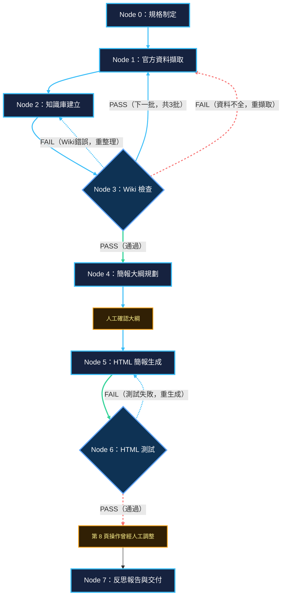

# Unity 2D 教學簡報製作流程（Graph／Loop）

本文件提供專案工作流程之可編輯 Mermaid 原始碼，採直式簡潔架構設計，清楚呈現 Node 0～7 之推進順序、Node 3 與 Node 6 菱形判斷、失敗返回迴圈（Loop）與人機協同標示。

---

## 一、 Mermaid 流程圖原始碼（簡潔版）

---

## 二、 流程設計與圖面重點說明

1. **核心流程清晰直觀**：
   * 採用直式向下推進，各節點僅保留核心繁體中文功能名稱（Node 0～7）。
   * 老師在 10 秒內即可掌握從官方資料 Ingest、提煉 Wiki，到大綱審查、HTML 簡報生成、測試與最終交付的完整生命週期。
2. **菱形檢驗與 Loop 閉環**：
   * 僅在 **Node 3（Wiki 檢查）** 與 **Node 6（HTML 測試）** 設置菱形判斷框。
   * 檢查失敗時以**紅色虛線箭頭**清楚指向退回節點（Node 3 失敗退回 Node 1 或 Node 2；Node 6 失敗退回 Node 5），展現嚴謹的自我修正迴圈。
3. **人機協同（HITL）簡單標示**：
   * 階段間的人工介入以精巧的琥珀金色標籤嵌入流程線中（「人工確認大綱」與「第 8 頁操作曾經人工調整」），不干擾主流程視覺。
4. **真實執行紀錄標記**：
   * 圖片下方註明：「**本次自動重試 0 次；第 8 頁操作方式曾經人工調整。**」，如實反映實務執行成果。
